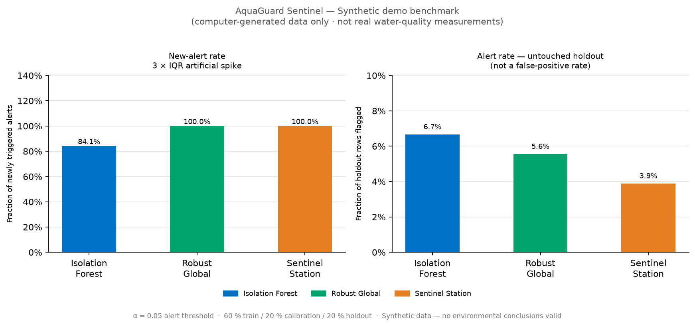
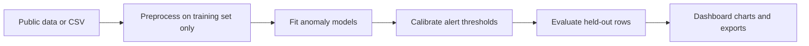

# 💧 AquaGuard Sentinel

**Open-data water-quality anomaly explorer** · Python · Streamlit · scikit-learn

A reproducible, interactive app for exploring unusual **sensor measurements** in water-quality datasets. Compare robust statistics, Isolation Forest, and a station-aware calibration baseline, with explicit train / calibration / holdout separation.

> **Important:** This is an educational ML portfolio project, **not a pollution, pathogen, or water-potability detector**. All simulated stress tests inject artificial disturbances into measurements; no benchmark here establishes accuracy for real contamination events.



## Features

- **Interactive dashboard:** switch between synthetic demo, public UCI wastewater, NYC drinking-water, USGS monitoring, or your own CSV.
- **Transparent methods:** global robust median/IQR scoring, Isolation Forest, and station-aware scoring with conformal calibration.
- **Reproducible experiments:** seeded spike / drift / missing-data tests with exported CSV tables and JSON manifests.
- **Leakage-conscious evaluation:** 60 % train, 20 % calibration, 20 % holdout in source or timestamp order.
- **Missingness handling:** abstains from alerting when fewer than half of sensor channels are observed.
- **Automated tests and CI:** 12-test unittest suite plus GitHub Actions on Python 3.10 and 3.12.

---

## Quick start

See the detailed [setup and publishing guide](START_HERE.md).

Requires **Python 3.10 or newer**.

**Windows (one click):** double-click `START_WINDOWS.cmd` — it creates a virtual environment, installs packages, and opens the dashboard.

**Any OS (terminal):**

```bash
python -m venv .venv
# Windows PowerShell:  .\.venv\Scripts\Activate.ps1
# macOS / Linux:       source .venv/bin/activate
pip install -r requirements.txt
python -m unittest discover -s tests -v
streamlit run app.py
```

Open the URL printed in your terminal (usually `http://localhost:8501`).

**Quickest demo:** select *Synthetic demo (offline)* and click *Run transparent comparison* — no internet required, completes in seconds.

---

## Use a real public dataset

### UCI Water Treatment Plant

Select *UCI wastewater (local / internet)* in the dashboard.

The app automatically downloads `water-treatment.data` from the UCI legacy mirror on first use and caches it in `data/`. The file is excluded from version control (`.gitignore`) in accordance with UCI's data terms.

- Dataset page: <https://archive.ics.uci.edu/dataset/106/water+treatment+plant>
- License: **CC BY 4.0** — Poch, M. (1993). doi:[10.24432/C5FS4C](https://doi.org/10.24432/C5FS4C)
- 527 historical records · 38 numeric measurement channels · one wastewater facility

> **Note:** The `ucimlrepo` Python API no longer serves dataset 106 programmatically (confirmed 2026-10). The app uses the stable UCI legacy file URL instead.

To skip the automatic download, place `water-treatment.data` manually in the `data/` folder:

```
data/water-treatment.data
```

### Other datasets

| Dataset | How to use |
|---|---|
| NYC Drinking Water | Select in dashboard; uses NYC Open Data API |
| USGS River/Estuary | Select in dashboard; uses USGS NWIS API |
| Your own CSV | Upload via dashboard; needs ≥ 150 rows, ≥ 2 numeric columns |

NYC and USGS adapters rely on external APIs that may become unavailable. CSV upload is always a fallback. See [docs/DATASETS.md](docs/DATASETS.md).

**Run benchmark from the terminal:**

```bash
python -m aquaguard.experiment --dataset demo --out runs/demo
python -m aquaguard.experiment --dataset uci  --out runs/uci
```

---

## Methods at a glance

| Method | What it measures | Key limitation |
|---|---|---|
| Robust global | Max median/IQR-scaled feature deviation | One highly variable feature can dominate |
| Isolation Forest | Isolation-based outlier score | Sparse single-feature anomalies may be hard to flag |
| Sentinel station | Station-aware robust deviation + conformal calibration | With one site it may match the global baseline |



---

## Example exploratory results on UCI wastewater data

A reproducible experiment on the UCI Water Treatment Plant dataset (527 historical records, 38 numeric channels, one facility, 106 held-out rows):

| Method | Untouched holdout alert rate | New-alert rate at 5 × IQR spike |
|---|---|---|
| Isolation Forest | 2.83 % | **0.00 %** |
| Robust global | 1.89 % | **0.95 %** |
| Sentinel station | 1.89 % | **0.95 %** |

The near-identical robust and station-aware results are expected with a single site.
**These weak results are shown transparently — they are not evidence of real pollution detection.**
Input records are real historical measurements; the faults are injected in software.

Full results: [benchmarks/](benchmarks/) · Design notes: [docs/EVALUATION.md](docs/EVALUATION.md)

---

## Understanding results

- `mean_alert_rate` on **untouched** data = fraction flagged, **not** a false-positive rate.
- `mean_new_alert_rate` after **artificial spikes** = stress-test sensitivity, **not** pollution-detection accuracy.
- Conformal calibration is sensitive to distribution shift over time; coverage is not guaranteed under arbitrary shifts.
- Station-aware advantage requires data from multiple stations evaluated independently.

---

## Deploy to Streamlit Community Cloud

1. Push this repository (without `.venv/` or `data/*.data`) to a public GitHub repo.
2. Go to <https://share.streamlit.io> and click *New app*.
3. Select your repo, branch `main`, and main file `app.py`.
4. Click *Deploy* — no extra configuration needed.
5. On first load, the app will automatically download `water-treatment.data` from the UCI legacy mirror.

No secrets or API keys are required for the demo or UCI mode.

---

## Project structure

```
app.py                       Streamlit dashboard
aquaguard/
  loaders.py                 Public dataset adapters
  model.py                   Anomaly scoring and conformal calibration
  experiment.py              Reproducible benchmark runner
  fetch_uci.py               Thin data-fetch helper (not research code)
tests/
  test_sentinel.py           12-test unittest suite
docs/
  DATASETS.md                Data provenance and terms
  EVALUATION.md              Benchmark design and interpretation
  PORTFOLIO_DESCRIPTION.md   Scholarship application guidance
benchmarks/
  uci_v3_exploratory_summary.csv    Canonical UCI results
  uci_v3_exploratory_manifest.json  Run metadata
assets/
  synthetic_demo_benchmark.png
.streamlit/
  config.toml                Theme and server settings
.github/workflows/tests.yml  CI — runs tests on Python 3.10 and 3.12
START_WINDOWS.cmd            One-click Windows start
RUN_TESTS_WINDOWS.cmd        One-click local test runner
```

---

## Possible future improvements

- Independently tested data from multiple monitoring stations.
- Sensitivity improvements for isolated single-sensor faults.
- An independently labeled contamination-event dataset for honest evaluation.

These are ideas — **not implemented or validated**.

---

## Attribution and responsible use

Code was developed with AI assistance. The project owner should review, run, understand, and independently verify all results before presenting it as personal work. Dataset providers retain their own terms. Do not use anomaly scores to make public-health decisions.

**License:** MIT for original project code. Public datasets are separately licensed by their publishers (see [docs/DATASETS.md](docs/DATASETS.md)).
